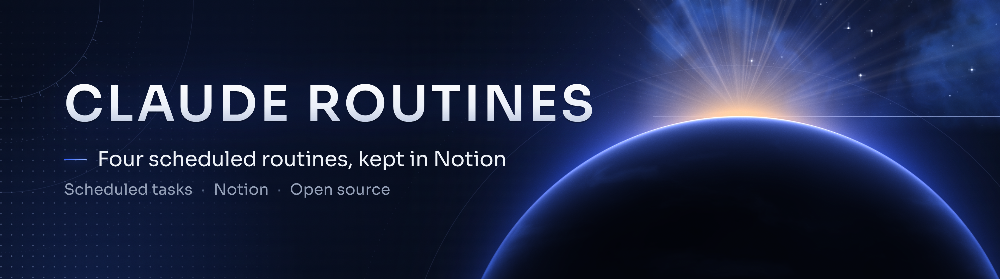

  

  
  
  

# claude-routines

**4 routines Claude prêtes à programmer : veille quotidienne, mail à la famille, suivi du soir, revue hebdomadaire. Tout est rangé dans Notion.**
*Four ready-to-schedule Claude routines that keep a Notion workspace up to date.*

## ✦ Ce que ça fait

| Routine | Quand | Ce qu'elle produit |
|---|---|---|
| [Veille quotidienne](routines/01-veille-quotidienne.md) | chaque matin | 6 vidéos YouTube + 6 actualités vérifiées (liens testés, dates contrôlées, pas de doublon), triées selon tes retours *Utile* / *Pas intéressant*. Récap automatique le lundi. |
| [Envoi famille](routines/02-envoi-famille.md) | 18 h | Un mail HTML soigné avec les éléments que **tu** as marqués « oui ». Rien n'est envoyé sans ta validation. |
| [Suivi du soir](routines/03-suivi-du-soir.md) | 23 h | Ce que tu as fait, décidé, ce qui bloque, une note honnête de la journée et une proposition pour demain. |
| [Revue du mardi](routines/04-revue-du-mardi.md) | mardi midi | Où est passé ton temps, ce qui se répète, et des propositions de skills ou de mods sur mesure. |

Les routines se répondent entre elles : tes retours sur la veille orientent la veille suivante, et le suivi du soir prépare le sujet du lendemain.

## ✦ Principes

- **Claude prépare, tu valides.** Aucune routine ne publie, n'achète ou ne crée de compte. L'envoi famille ne part qu'aux adresses écrites dans tes Réglages, et seulement pour ce que tu as coché.
- **Rien d'inventé.** Chaque lien est ouvert avant d'être gardé, et les éléments sans date vérifiée sont écartés.
- **Peu de tokens.** Le nombre de recherches est plafonné, les sorties tiennent en quelques lignes.

## ✦ Installation

1. Crée dans Notion la structure décrite dans [`notion-structure.md`](notion-structure.md).
2. Connecte Notion à Claude (et Gmail si tu veux l'envoi famille).
3. Pour chaque routine, crée une tâche programmée dans Claude et colle le prompt du fichier correspondant.
4. Remplace les repères `<VIDEOS>`, `<PAGE_REGLAGES>`, etc. par les liens de tes pages et bases Notion.
5. Lance chaque routine une fois à la main pour vérifier.

Le suivi du soir peut aussi lire un dossier `Projets` sur ton ordinateur (voir [claude-second-brain](https://github.com/horizonchapter/claude-second-brain)).

## ✦ Voir aussi

- [claude-second-brain](https://github.com/horizonchapter/claude-second-brain) : la mémoire de travail partagée entre Claude et Claude Code.
- [chef-employe](https://github.com/horizonchapter/chef-employe) : déléguer le travail mécanique à des sous-agents moins chers.
- [pdf-luxe](https://github.com/horizonchapter/pdf-luxe) : des PDF au rendu haut de gamme.

## ✦ Licence

MIT, Horizon Chapter.
